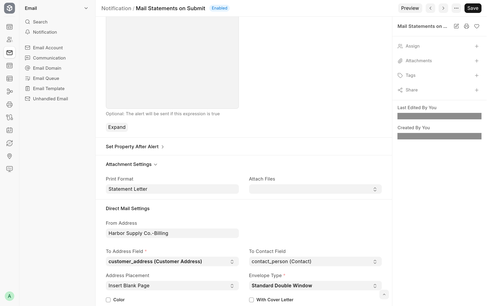

Some customers and suppliers still need paper: invoices, statements, notices and purchase orders. Direct Mail via PostGrid mails the printed version of a Frappe or ERPNext document as a physical letter through [PostGrid's Print & Mail API](https://www.postgrid.com/ref/avunu), so nobody has to print, fold, stuff or stamp anything. PostGrid prints and posts the letter, and its delivery status comes back to the document's timeline.

It is for teams that send documents by post and want the letter recorded on the document it came from. Letters go to any Frappe Address, optionally to the attention of a Contact, so they work for customers, suppliers, employees and any other DocType that links to an address. It runs on Frappe v16, ERPNext is optional, and it is free software under the [MIT licence](../license.txt).

## What you get

### A Mail button on the print view

The print view of every submitted document has a **Mail** button. It opens the **Mail Letter** dialog with the sender, recipient and contact filled in from the document, and mails the print format you are looking at, with an optional cover letter in front. See [Mail a document](mail-a-document.md).

### Letters from Notifications

A **Mailed Letter** channel on Notification mails the document on the New, Save, Submit and Cancel events, a number of days before or after a date, or on a document method. See [Mail documents from a Notification](notifications.md).

### Delivery status in the timeline

Each letter appears in the document's timeline with its recipient, its delivery status and a link to the letter in the PostGrid dashboard. PostGrid's webhook keeps the status current, and the app can keep a copy of PostGrid's PDF and update addresses with PostGrid's verified version. See [Track mailed letters](track-letters.md).

### One settings page

**PostGrid Settings** holds the Test and Live API keys, the mode in use and the default mailing options the Mail dialog starts from. See [Configuration](configuration.md).

## Where to start

| You are                            | Read                                                                                                                            |
| ---------------------------------- | ------------------------------------------------------------------------------------------------------------------------------- |
| A user mailing documents           | [Mail a document](mail-a-document.md), then [Track mailed letters](track-letters.md)                                            |
| The administrator setting it up    | [Install and upgrade](install.md), [Configuration](configuration.md) and [Mail documents from a Notification](notifications.md) |
| Anyone whose letter did not go out | [Limitations and troubleshooting](troubleshooting.md)                                                                           |
| A developer changing the app       | [Development](development/README.md) and [How it works](development/architecture.md)                                            |

## Requirements

- A bench with Frappe v16. The app declares `frappe >=16.0.0,<17.0.0`.
- No other Frappe app. With ERPNext installed, the Mail dialog and the Notification form also fall back to the company's default address for the sender.
- A PostGrid Print & Mail account and its Test or Live API key.
- A site that PostGrid can reach over the internet, for delivery status updates.

## Source and changes

The source is at [github.com/Avunu/postgrid_direct_mail](https://github.com/Avunu/postgrid_direct_mail). Release notes are on the [releases page](https://github.com/Avunu/postgrid_direct_mail/releases).
